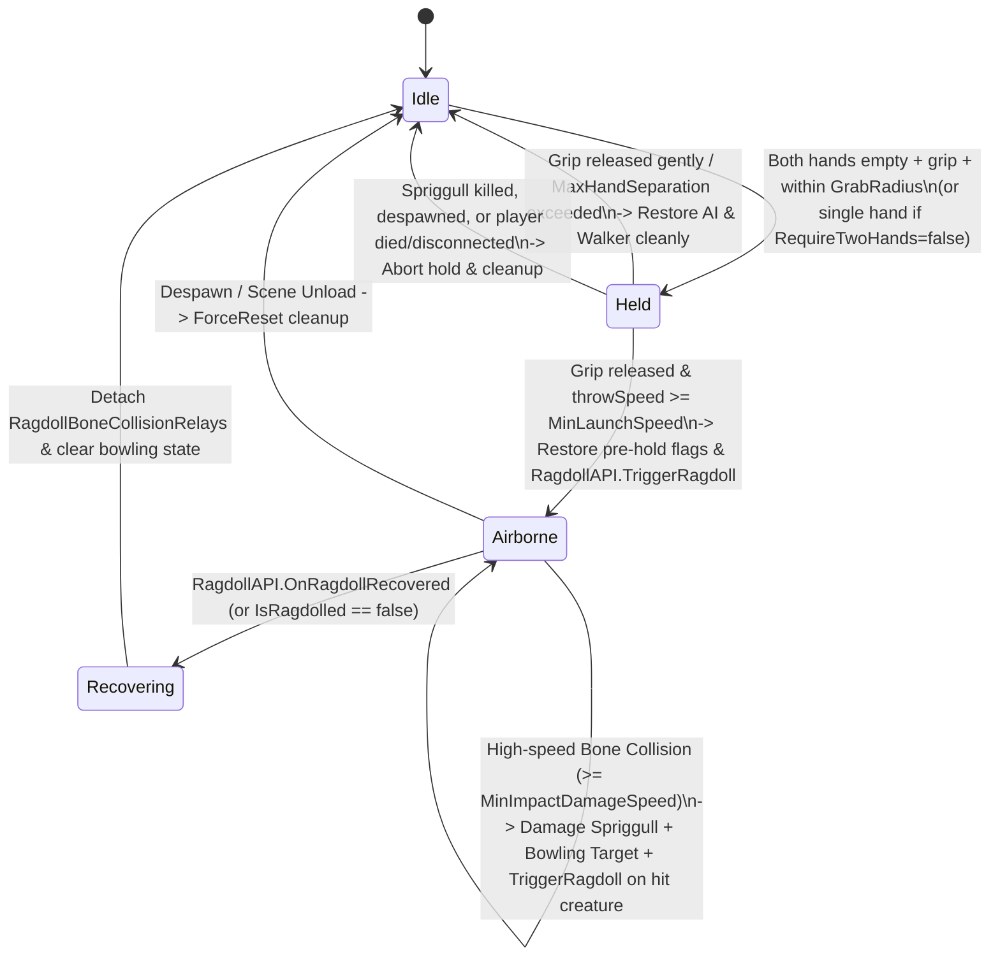

# SpriggullYeeter — Architecture & Technical Design

All *A Township Tale* (ATT) runtime details, assembly names, component hierarchies, `RagdollLib` public API signatures, and VR input bindings documented here were verified directly against the installed game binaries and sibling `RagdollLib` source in this workspace:
- `A Township Tale_Data/Managed/Root.Township.dll` (main game assembly; no `Assembly-CSharp.dll` exists)
- `MelonLoader/net35/MelonLoader.dll` & `0Harmony.dll` (`MelonLoader v0.7.3 Open-Beta`, `MonoBleedingEdge` x64, Unity `2020.3.23f1`)
- `Mods/RagdollLib.dll` and `Source/RagdollLib/RagdollLib/API/RagdollAPI.cs`
- `MelonLoader/GameObjectDump.txt` (verified live `Spriggull(Clone)` and `VR Player Character New(Clone)` hierarchies)

---

## 1. Runtime, Mod Loader & Hard Dependency Linkage

| Component | Verified Value | Notes |
|---|---|---|
| Scripting Backend | **MonoBleedingEdge** (x64, `A Township Tale_Data/Managed/*.dll`) | Standard Mono `.NET` runtime; custom `MonoBehaviour`s register natively |
| Mod Loader | **MelonLoader `v0.7.3 Open-Beta`** (`Runtime Type: net35`) | Loads mods from `Mods/` and dependencies before mod initialization |
| Unity Version | `2020.3.23f1` | `UnityEngine.CoreModule`, `PhysicsModule`, `AnimationModule`, `XRModule`, `InputLegacyModule` |
| Game Identity | `[assembly: MelonGame("Alta", "A Township Tale")]` | Main game assembly is `Root.Township.dll` |
| `SpriggullYeeter.Core` | `netstandard2.0` | Pure C# vector math, velocity ring buffer, throw/impact calculators, state machine, config snapshot |
| `SpriggullYeeter` | `.NET Framework 4.7.2` (`net472`) | Compiles `SpriggullYeeter.Core` directly into standalone `SpriggullYeeter.dll` |
| `SpriggullYeeter.Tests` | `.NET 8.0` (`net8.0`, xUnit) | Offline unit tests covering ring-buffer physics, calculators, state machine, and config clamping |

### Hard Dependency on `RagdollLib.dll`
- **Project Reference**: `SpriggullYeeter.csproj` references `$(GameDir)\Mods\RagdollLib.dll` with `<Private>false</Private>` so `RagdollLib.dll` is never duplicated into build outputs or releases.
- **Loader Dependency Attribute**: `Properties/AssemblyInfo.cs` declares `[assembly: MelonAdditionalDependencies("RagdollLib")]` so MelonLoader enforces load ordering and surfaces missing-dependency diagnostics cleanly.
- **Verified `RagdollLib.API.RagdollAPI` Surface**:
  - `bool TriggerRagdoll(Component targetEntity, Vector3 impulseForce, Vector3 worldHitPoint, float durationSeconds = 3.0f)`
  - `bool TriggerRagdoll(Component targetEntity, Vector3 impulseForce, float durationSeconds = 3.0f)`
  - `void RecoverRagdoll(Component targetEntity)`
  - `bool IsRagdolled(Component targetEntity)`
  - `RagdollState GetRagdollState(Component targetEntity)`
  - `event Action<RagdollEventArgs> OnRagdollStarted`
  - `event Action<RagdollEventArgs> OnRagdollRecovered`
- **Dual-Capable Client + Server Deployment**: Because `RagdollLib` runs on both client and server (`NetworkSceneManager.IsServer`), `SpriggullYeeter.dll` is deployed to `Mods/` on **both client and server**:
  - **Server (`NetworkSceneManager.IsServer == true`)**: Authoritatively suspends Spriggull AI/pathfinding/pecking, updates held Spriggull root `Transform`/`Rigidbody` (replicated via `NetworkRigidbody`), invokes `RagdollAPI.TriggerRagdoll`, and dispatches authoritative `ImpactHit` damage for Spriggull bowling.
  - **Client (`NetworkSceneManager.IsServer == false`)**: Samples local XR grip (`UnityEngine.XR.InputDevices`) and hand kinematics, triggers controller haptic rumble (`Controller.TriggerHaptic`), plays native Spriggull squawks (`AudioManager.Instance` + `SoundEffect.SpriggullFlail` / `SpriggullAlert`) and native feather/hit bursts (`ImpactDetector.Settings.PlayEffects`), and triggers local visual `RagdollAPI.TriggerRagdoll` so the player immediately sees full articulated ragdoll flight.
  - **Host / Solo (`IsServer && !IsHeadless`)**: Both run cleanly in one process without duplicate state transitions.

---

## 2. Two-Handed VR Proximity + Grip Detection (Non-Inventory Grab)

### Why Spriggulls Are Never Made `Pickup` Items
In *A Township Tale*, `Pickup` + `Interactable` + `Dock` allow items to snap into hand `GripPoint`s, toolbelts, and backpacks. Attaching `Pickup` to a live `Spriggull(Clone)` would allow players to dock live creatures into inventory slots, conflict with `NetworkColliderGroup`/`Agent`, and break `RagdollLib` bone detachment.

Instead, **SpriggullYeeter** uses **proximity + grip + empty-hand validation**:
1. **Empty-Hand Guard (`VrHandInputReader.IsHandEmpty`)**:
   - Inspects `Controller.Interactor` (`!IsInteracting && InteractingWith == null`) and `Controller.TryGetHeldPickup(out Pickup held) && held == null`.
   - If the player is already holding a weapon/item or interacting with a dock/lever, that hand cannot grab a Spriggull.
2. **VR Grip Detection (`VrHandInputReader.IsGripPressed`)**:
   - **Local VR Player**: Queries `UnityEngine.XR.InputDevices.GetDeviceAtXRNode(XRNode.LeftHand / RightHand)` for `CommonUsages.gripButton` or `CommonUsages.grip >= 0.70f`, falling back to ATT's replicated `HandGestureController.gripAxis >= 0.70f`.
   - **Remote Server Players**: Reads ATT's replicated `HandGestureController.gripAxis >= 0.70f` via cached Harmony `FieldRefAccess`.
3. **Proximity & Target Filtering**:
   - Computes hand midpoint (when `RequireTwoHands = true`, both hands must be within `GrabRadius`, default `0.4m`, of the same live Spriggull and within `MaxHandSeparation`, default `1.1m`, of each other; when `RequireTwoHands = false`, either empty gripped hand within `GrabRadius` can grab).
   - Validates `Alta.Intelligence.Spriggull`, `HealthObject.Health > 0f`, not already held by another player, and not currently dead.
   - If the Spriggull is currently ragdolled (`RagdollAPI.IsRagdolled`), calls `RagdollAPI.RecoverRagdoll` cleanly before transitioning to `Held` so bones are re-parented and ready for carry.

---

## 3. Rolling Velocity Ring-Buffer Math (~80ms Window)

VR players naturally begin relaxing their Grip fingers ~20–40ms *after* peak wrist whip, which causes single-frame release velocity (`deltaPos / dt` on the release tick) to read near zero ("finger-release slowdown artifact").

`SpriggullYeeter.Core.Physics.VelocityRingBuffer` eliminates this artifact:
- **Capacity & Window**: Fixed-size 16-slot circular buffer covering an `80ms` (`0.080s`) sliding window (6–8 frames at 72–90 Hz).
- **Sample Sanitization**:
  - Rejects non-finite coordinates (`NaN` / `Infinity`).
  - Rejects single-step teleports (`distance > 1.5m` in one frame, e.g., player teleport locomotion or chunk origin shift) by resetting the buffer rather than injecting synthetic multi-hundred m/s spikes.
- **Velocity Extraction (`ComputeReleaseVelocity`)**:
  - Scans adjacent valid samples inside the `80ms` window to compute instantaneous segment velocities $\vec{v}_i = \frac{\vec{p}_i - \vec{p}_{i-1}}{\Delta t_i}$ (for $\Delta t_i \ge 0.001\text{s}$).
  - Computes the **peak segment velocity** $\vec{v}_{\text{peak}}$ (highest speed over the last 80ms) and the **recent window average velocity** $\vec{v}_{\text{avg}} = \frac{\vec{p}_{\text{newest}} - \vec{p}_{\text{oldest}}}{t_{\text{newest}} - t_{\text{oldest}}}$.
  - Blends `0.65 * v_peak + 0.35 * v_avg` (when aligned in direction, otherwise favors `v_peak`), preserving crisp peak flick magnitude while smoothing micro-jitter.
- **Two-Hand Combination & Impulse Conversion (`YeetPhysicsCalculator`)**:
  - Averages the two hand release velocities when both hands contributed (`0.5 * (v_L + v_R)`), or uses the active throwing hand if one hand lagged, scales by `YeetForceMultiplier` (default `1.6f`), and clamps speed to `28 m/s`.
  - Adds a subtle upward arc assist (`+0.12 * speed` on Y) and converts throw velocity to a `RagdollAPI.TriggerRagdoll` impulse vector: $\vec{J} = m_{\text{eff}} \cdot \vec{v}_{\text{throw}}$ ($m_{\text{eff}} = 22\text{ kg}$, capped at `650 N*s`) applied at the release midpoint.

---

## 4. State Machine & Edge Cases

### Verified `Spriggull(Clone)` Component Suspension & `RagdollLib` Handoff
1. **While `Held` (`HeldSpriggullSession`)**:
   - Captures original state of `Agent.IsEnabled`, `Walker.enabled`, `Spriggull.beak` (`FixedImpactor.enabled`), `Rigidbody.isKinematic` / `detectCollisions`, and `NetworkRigidbody.isSuspended` (non-server).
   - Suspends `Agent.IsEnabled = false` (server), `Walker.StopNormalizedMove()` + `Walker.enabled = false`, `Navigator.Stop()`, `Director.Stop()`, disables `beak` so carried Spriggulls do not peck the player, sets root `Rigidbody.isKinematic = true`, and smoothly moves/rotates the Spriggull root toward the midpoint between the player's hands with gentle procedural squirm and periodic `SpriggullFlail` squawks + controller haptic pulses (`0.18` strength).
2. **Critical Pre-Ragdoll Restoration**:
   - `RagdollLib`'s `RagdollController.CaptureAndDisableControllers()` snapshots `.enabled` and `Agent.IsEnabled` at the moment `TriggerRagdoll` is called so it can restore them after recovery.
   - Therefore, right before calling `RagdollAPI.TriggerRagdoll(...)`, `HeldSpriggullSession` restores the saved pre-hold controller enabled flags (in the same frame, before any `FixedUpdate`/AI tick), so `RagdollLib` snapshots the true baseline and restores full Spriggull AI after recovery.
3. **Detached Pelvis & Collision Relays (`AirborneSpriggullTracker` + `RagdollBoneCollisionRelay`)**:
   - `RagdollController.EnterRagdollPhysics()` detaches `skin_root_jnt` (`SetParent(null, true)`) on non-local entities. Calling `GetComponentsInChildren<Rigidbody>()` on the Spriggull root *after* `TriggerRagdoll` would miss the detached pelvis and limbs.
   - **Solution**: `AirborneSpriggullTracker` collects all bone `Transform`s from the Spriggull's `SkinnedMeshRenderer.bones` (which remain valid references even while detached) and attaches `RagdollBoneCollisionRelay` to every bone with an active `Rigidbody`.
   - Self-collisions between bones of the same Spriggull and brief collisions with the throwing player (`0.25s` grace window) are ignored.
   - Impact collisions with speed `>= MinImpactDamageSpeed` dispatch `ImpactHit` (`ImpactType.Blunt`) on the server to both the thrown Spriggull and any non-player creature hit (with a `0.35s` per-target cooldown), and also call `RagdollAPI.TriggerRagdoll` on the struck creature for Spriggull bowling.
4. **Edge Cases Handled**:
   - **Hands pulled apart (`> MaxHandSeparation`)**: Immediately releases hold cleanly back to `Idle` without launching.
   - **Spriggull killed while held**: `HealthObject.OnKilled` Harmony postfix + per-tick health check immediately aborts the hold cleanly so `RagdollLib`'s `RagdollOnDeath` can take over without fighting.
   - **Entity despawned / pooled / scene unloaded**: `NetworkEntity.OnDestroyedByScene`, `NetworkEntity.OnDestroy`, and `OnSceneWasUnloaded` abort active holds, destroy all `RagdollBoneCollisionRelay` components (including on detached pelvises), and clear tracked players.
   - **Player death or disconnect**: `PlayerYeetHandler` checks `IsAlive && !IsDowned && !IsSpirit` every tick and drops any held Spriggull safely; `YeetManager` prunes disconnected players.
